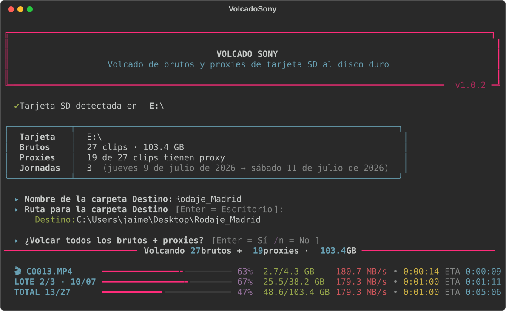

# VolcadoSony

**[Versión en español aquí](README.md)**


Offload **Sony camera** memory cards to your hard drive, in text mode with
a polished console UI: colors, triple progress bars (current file, batch,
total), transfer speed, elapsed time and ETA. The interface is in Spanish.

Works with **any Sony camera that records XAVC S / XAVC HS** — Alpha, ZV,
RX, FX3/FX30, compacts and 4K Handycams — since they all share the same card
structure. [Full list here](#compatible-cameras).



## What it does

1. Auto-detects the SD card (scans all drives for
   `drive:\PRIVATE\M4ROOT\CLIP`). If several cards are present, it asks which
   one to use.
2. Asks for the **name** of the destination folder.
3. Asks for the destination **path** (Enter = Windows Desktop).
4. Asks whether to offload **everything** (Enter = yes, `n` = no).
   - If you answer `n`, it groups the footage into **batches per shooting
     day** (recording date) and offers each batch one by one. All selected
     batches go to the same destination folder.
5. Copies the camera originals batch by batch in chronological order; each
   original is followed by its camera metadata XML sidecar (into the `_xml\`
   subfolder) and its proxy (into the `Proxies\` subfolder, renaming the `S03`
   suffix to `_Proxy`, e.g. `C0001S03.MP4` → `C0001_Proxy.MP4`). Orphan
   proxies (with no matching original) are skipped.
6. Writes a `volcado_YYYYMMDD_HHMMSS.txt` log in the destination with the
   details of every file.

## Compatible cameras

It works with **any Sony camera recording XAVC S, XAVC S-I or XAVC HS**:
they all store the originals in `PRIVATE\M4ROOT\CLIP` and the proxies in
`PRIVATE\M4ROOT\SUB`.

- **Cinema Line**: FX3, FX30
- **Full-frame Alpha**: A7S, A7S II, A7S III · A7 II\*, A7 III, A7 IV ·
  A7R II, A7R III, A7R IV, A7R V · A7C, A7C II, A7CR · A9, A9 II, A9 III ·
  A1, A1 II
- **APS-C Alpha**: A6100, A6300, A6400, A6500, A6600, A6700
- **ZV series**: ZV-1, ZV-1 II, ZV-1F, ZV-E10, ZV-E10 II, ZV-E1
- **RX series**: RX100 III to VII · RX10\* and RX10 II to IV · RX0, RX0 II ·
  RX1R II
- **Travel compacts**: HX95, HX99, WX700, WX800
- **4K Handycam**: FDR-AX33, AX40, AX43, AX45, AX53, AX60, AX100, AX700
  (and AXP projector variants)
- **Compact pro camcorders**: HXR-NX80, PXW-Z90 (in XAVC S mode)
- **A-mount**: A99 II

\* The original A7 II and RX10 need firmware 2.0, which added XAVC S.

Not every model records proxies (only those with *Proxy Recording*); on the
rest there is simply nothing to copy into `Proxies\`.

**Not compatible**: the FX6, FX9, Burano and Venice cinema cameras and XDCAM
gear use a different structure (`PRIVATE\XDROOT`, MXF files), and models that
only record AVCHD/MP4 (A6000, A5100, original RX100s...) never create the
`M4ROOT` folder.

## Download

Grab `VolcadoSony.exe` from the [**Releases**](../../releases) page. No
installation, no dependencies: double-click with the card inserted.

You can also run it from a console:

```
VolcadoSony.exe            # auto-detects the card
VolcadoSony.exe E:\        # force that drive as the source
```

Or straight with Python:

```
pip install -r requirements.txt
python volcado_sony.py
```

## How it works

- **Recording date**: read from the camera XML sidecar (`CXXXXM01.XML`,
  `CreationDate` field), which is reliable even when filesystem dates are
  not. Clips without an XML fall back to the file date.
- **Proxies**: looked up in `PRIVATE\M4ROOT\SUB` (their actual location on
  Sony cameras) and also in `PRIVATE\M4ROOT\CLIP`.
- **Safe copies**: each file is copied to a temporary `.part` file that is
  only renamed to its final name once the copy completes and the size
  matches. Original file timestamps are preserved.
- **Resumable**: files that already exist in the destination with the same
  size are skipped, so an interrupted offload can be relaunched without
  recopying anything.
- **Disk space**: free space at the destination is checked before starting.

## Building the .exe

```
pip install rich pyinstaller
pyinstaller --onefile --console --name VolcadoSony ^
    --exclude-module numpy --exclude-module PIL ^
    --exclude-module PyQt5 --exclude-module matplotlib --exclude-module IPython ^
    volcado_sony.py
```

The executable lands in `dist\VolcadoSony.exe` (~11 MB, self-contained).

## Configuration

Constants at the top of `volcado_sony.py`:

| Constant | Default | Meaning |
|---|---|---|
| `COPIAR_XML` | `True` | Copy the camera XML sidecars into the `_xml\` subfolder |
| `CARPETA_XML` | `"_xml"` | Name of the XML sidecars subfolder |
| `CARPETA_PROXIES` | `"Proxies"` | Name of the proxies subfolder |
| `SUFIJO_PROXY_DESTINO` | `"_Proxy"` | Suffix used when renaming proxies |
| `CHUNK` | 8 MB | Copy block size |

## License

[MIT](LICENSE) — use it, modify it and share it freely.
