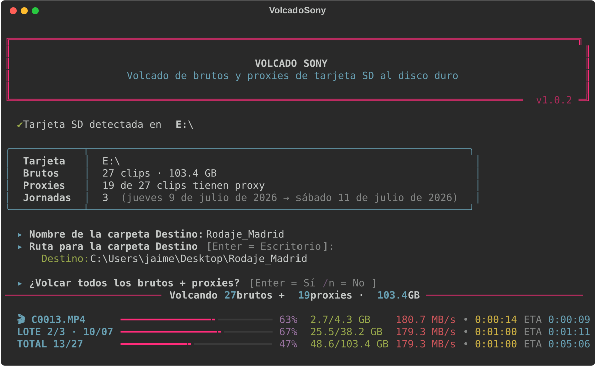

# VolcadoSony

**[English version here](README.en.md)**


Volcado de tarjetas SD de **Sony A7III / A7SIII** al disco duro, en modo texto
con una interfaz cuidada: colores, barras de progreso triples (fichero, lote,
total), velocidad, tiempo transcurrido y ETA.



## Qué hace

1. Detecta automáticamente la tarjeta SD (busca `unidad:\PRIVATE\M4ROOT\CLIP`
   en todas las unidades). Si hay varias, pregunta cuál usar.
2. Pregunta el **nombre** de la carpeta Destino.
3. Pregunta la **ruta** de la carpeta Destino (Enter = Escritorio de Windows).
4. Pregunta si quieres volcar **todo** (Enter = sí, `n` = no).
   - Si respondes `n`, agrupa los brutos en **lotes por jornada** (fecha de
     grabación) y va preguntando lote a lote. Todos los lotes seleccionados
     van a la misma carpeta Destino.
5. Copia los brutos (y sus XML de metadatos de cámara) a la carpeta Destino,
   por lotes en orden cronológico.
6. Copia los proxies de los brutos copiados a la subcarpeta `Proxies\`,
   renombrando el sufijo `S03` por `_Proxy` (ej. `C0001S03.MP4` →
   `C0001_Proxy.MP4`). Los proxies sin bruto asociado no se copian.
7. Deja un registro `volcado_AAAAMMDD_HHMMSS.txt` en el Destino con el detalle
   de cada fichero.

## Descarga

Descarga `VolcadoSony.exe` desde la página de
[**Releases**](../../releases). No necesita instalación ni dependencias:
doble clic con la tarjeta insertada y listo.

También puedes ejecutarlo desde consola:

```
VolcadoSony.exe            # detecta la tarjeta automáticamente
VolcadoSony.exe E:\        # fuerza esa unidad como origen
```

O directamente con Python:

```
pip install -r requirements.txt
python volcado_sony.py
```

## Detalles de funcionamiento

- **Fecha de grabación**: se lee del XML de la cámara (`CXXXXM01.XML`,
  campo `CreationDate`), que es fiable aunque la fecha del sistema de archivos
  no lo sea. Si un clip no tiene XML, se usa la fecha del fichero.
- **Proxies**: se buscan en `PRIVATE\M4ROOT\SUB` (ubicación real en las Sony)
  y también en `PRIVATE\M4ROOT\CLIP`.
- **Copias seguras**: se copia a un fichero temporal `.part` que solo se
  renombra al nombre final si la copia se completa y el tamaño coincide.
  Se conservan las fechas originales de los ficheros.
- **Reanudable**: si un fichero ya existe en el destino con el mismo tamaño,
  se omite. Puedes relanzar un volcado interrumpido sin recopiar nada.
- **Espacio**: comprueba el espacio libre del destino antes de empezar.

## Compilar el .exe

```
pip install rich pyinstaller
pyinstaller --onefile --console --name VolcadoSony ^
    --exclude-module numpy --exclude-module PIL ^
    --exclude-module PyQt5 --exclude-module matplotlib --exclude-module IPython ^
    volcado_sony.py
```

El ejecutable queda en `dist\VolcadoSony.exe` (~11 MB, autónomo).

## Configuración

Constantes al principio de `volcado_sony.py`:

| Constante | Por defecto | Significado |
|---|---|---|
| `COPIAR_XML` | `True` | Copiar los sidecars XML de la cámara junto a los brutos |
| `CARPETA_PROXIES` | `"Proxies"` | Nombre de la subcarpeta de proxies |
| `SUFIJO_PROXY_DESTINO` | `"_Proxy"` | Sufijo con el que se renombra el proxy |
| `CHUNK` | 8 MB | Tamaño de bloque de copia |

## Licencia

[MIT](LICENSE) — úsalo, modifícalo y compártelo libremente.
