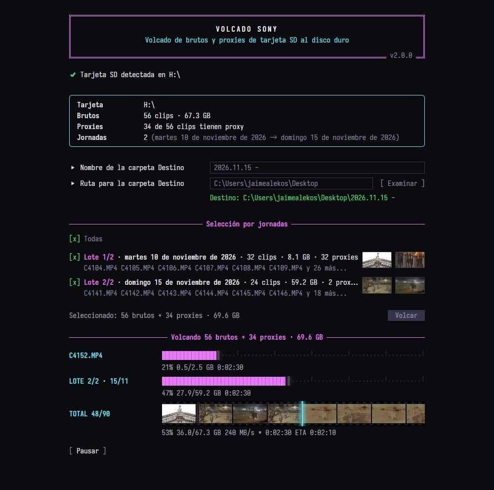

# VolcadoSony

**[English version here](README.en.md)**


Volcado de tarjetas de memoria de **cámaras Sony** al disco duro, en una sola
ventana con estética de consola: barras de progreso triples (fichero, lote,
total), velocidad, tiempo transcurrido y ETA.

Funciona con **cualquier cámara Sony que grabe XAVC S / XAVC HS** — Alpha,
ZV, RX, FX3/FX30, compactas y Handycam 4K — porque todas usan la misma
estructura de tarjeta. [Lista completa aquí](#cámaras-compatibles).



## Qué hace

Todo ocurre en la misma ventana, de arriba abajo:

1. Detecta automáticamente la tarjeta SD (busca `PRIVATE\M4ROOT\CLIP` en todas
   las unidades). Si hay varias, eliges cuál; si no hay ninguna, puedes escribir
   la unidad o buscar de nuevo.
2. Muestra el resumen: brutos, proxies, proxies huérfanos y jornadas.
3. Pide el **nombre** de la carpeta Destino y su **ruta** (vacía = Escritorio;
   botón *Examinar* para elegirla).
4. Las **jornadas** (fecha de grabación) aparecen en líneas con casilla, todas
   marcadas al empezar: desmarca las que no quieras volcar y pulsa *Volcar*.
   Si no hay espacio libre suficiente, avisa y deja continuar o cancelar.
5. Copia los brutos por lotes en orden cronológico; cada bruto va seguido de
   su XML de metadatos de cámara (a la subcarpeta `_xml\`) y de su proxy (a
   la subcarpeta `Proxies\`, renombrando el sufijo `S03` por `_Proxy`, ej.
   `C0001S03.MP4` → `C0001_Proxy.MP4`). Los proxies sin bruto asociado no se
   copian.
6. Deja un registro `volcado_AAAAMMDD_HHMMSS.txt` en el Destino con el detalle
   de cada fichero.

## Cámaras compatibles

Sirve para **cualquier cámara Sony que grabe XAVC S, XAVC S-I o XAVC HS**:
todas guardan los brutos en `PRIVATE\M4ROOT\CLIP` y los proxies en
`PRIVATE\M4ROOT\SUB`.

- **Cinema Line**: FX3, FX30
- **Alpha full-frame**: A7S, A7S II, A7S III · A7 II\*, A7 III, A7 IV ·
  A7R II, A7R III, A7R IV, A7R V · A7C, A7C II, A7CR · A9, A9 II, A9 III ·
  A1, A1 II
- **Alpha APS-C**: A6100, A6300, A6400, A6500, A6600, A6700
- **Serie ZV**: ZV-1, ZV-1 II, ZV-1F, ZV-E10, ZV-E10 II, ZV-E1
- **Serie RX**: RX100 III a VII · RX10\* y RX10 II a IV · RX0, RX0 II ·
  RX1R II
- **Compactas de viaje**: HX95, HX99, WX700, WX800
- **Handycam 4K**: FDR-AX33, AX40, AX43, AX45, AX53, AX60, AX100, AX700
  (y variantes AXP con proyector)
- **Videocámaras pro compactas**: HXR-NX80, PXW-Z90 (en modo XAVC S)
- **Montura A**: A99 II

\* Los A7 II y RX10 originales necesitan el firmware 2.0, que añadió XAVC S.

No todos los modelos generan proxies (solo los que tienen *Proxy Recording*);
en los demás simplemente no habrá nada que copiar a `Proxies\`.

**No compatibles**: las cámaras de cine FX6, FX9, Burano y Venice y los
equipos XDCAM usan otra estructura (`PRIVATE\XDROOT`, ficheros MXF), y los
modelos que solo graban AVCHD/MP4 (A6000, A5100, RX100 originales...) no
generan la carpeta `M4ROOT`.

## Descarga

Descarga `VolcadoSony.exe` desde la página de
[**Releases**](../../releases). No necesita instalación ni dependencias:
doble clic con la tarjeta insertada y listo.

Necesita Microsoft Edge WebView2 Runtime (viene de serie en Windows 11).
Opcionalmente se le puede pasar la unidad de origen:

```
VolcadoSony.exe E:\        # usa esa unidad como origen
```

O directamente con Python:

```
pip install -r requirements.txt
python volcado_sony.py
```

## Detalles de funcionamiento

- **Fecha de grabación**: se lee del XML de la cámara (`CXXXXM01.XML`,
  campo `CreationDate`), que es fiable aunque la fecha del sistema de archivos
  no lo sea. Si un clip no tiene XML, se usa la fecha del fichero.
- **Proxies**: se buscan en `PRIVATE\M4ROOT\SUB` (ubicación real en las Sony)
  y también en `PRIVATE\M4ROOT\CLIP`.
- **Copias seguras**: se copia a un fichero temporal `.part` que solo se
  renombra al nombre final si la copia se completa y el tamaño coincide.
  Se conservan las fechas originales de los ficheros.
- **Reanudable**: si un fichero ya existe en el destino con el mismo tamaño,
  se omite. Puedes relanzar un volcado interrumpido sin recopiar nada.
- **Espacio**: comprueba el espacio libre del destino antes de empezar.

## Compilar el .exe

```
pip install -r requirements.txt pyinstaller pytest
powershell -NoProfile -ExecutionPolicy Bypass -File desplegar.ps1
```

`desplegar.ps1` pasa las pruebas (`python -m pytest -q`), compila con
`VolcadoSony.spec` y deja `dist\VolcadoSony.exe`.

## Mac

La interfaz es HTML/CSS/JS sobre pywebview, que en macOS usa WebKit: el mismo
código debería funcionar allí (`python volcado_sony.py`; la tarjeta se busca en
`/Volumes`). No se ha probado en un Mac ni hay empaquetado para él.

## Configuración

Constantes al principio de `volcadosony/nucleo.py`:

| Constante | Por defecto | Significado |
|---|---|---|
| `COPIAR_XML` | `True` | Copiar los sidecars XML de la cámara a la subcarpeta `_xml\` |
| `CARPETA_XML` | `"_xml"` | Nombre de la subcarpeta de sidecars XML |
| `CARPETA_PROXIES` | `"Proxies"` | Nombre de la subcarpeta de proxies |
| `SUFIJO_PROXY_DESTINO` | `"_Proxy"` | Sufijo con el que se renombra el proxy |
| `CHUNK` | 8 MB | Tamaño de bloque de copia |

## Licencia

[MIT](LICENSE) — úsalo, modifícalo y compártelo libremente.
